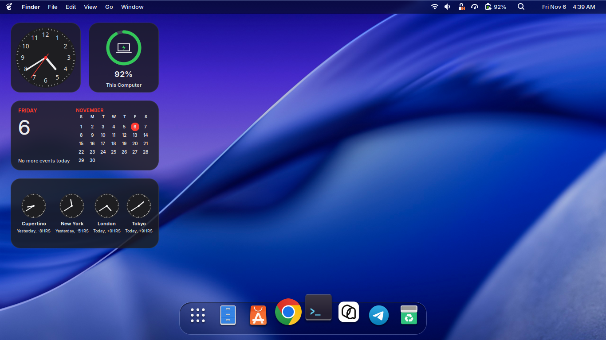
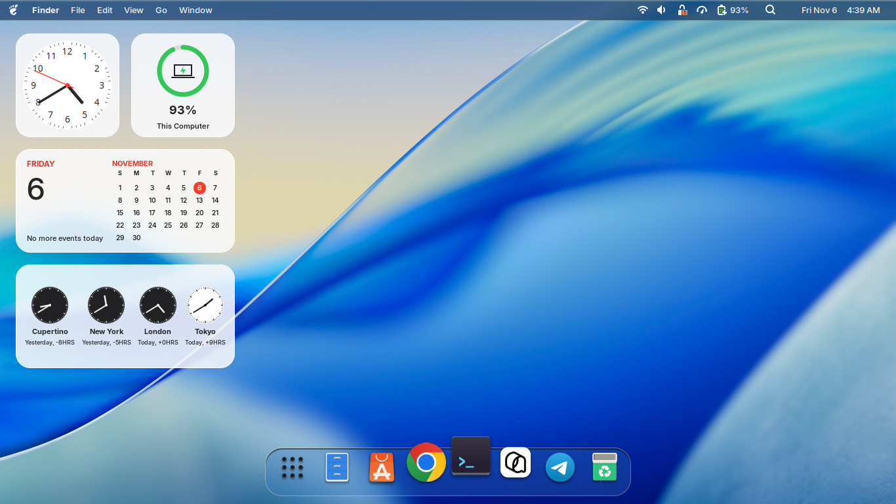
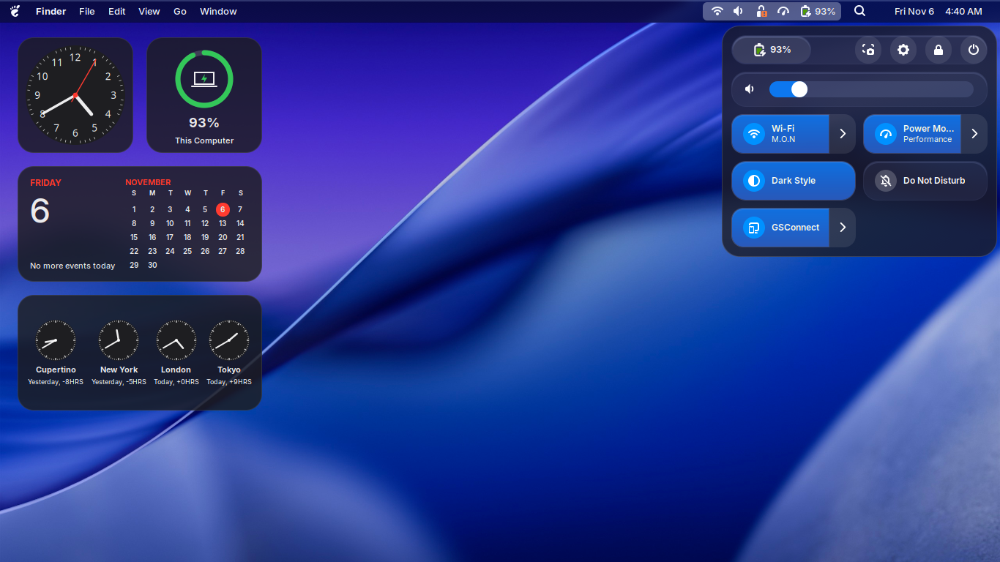
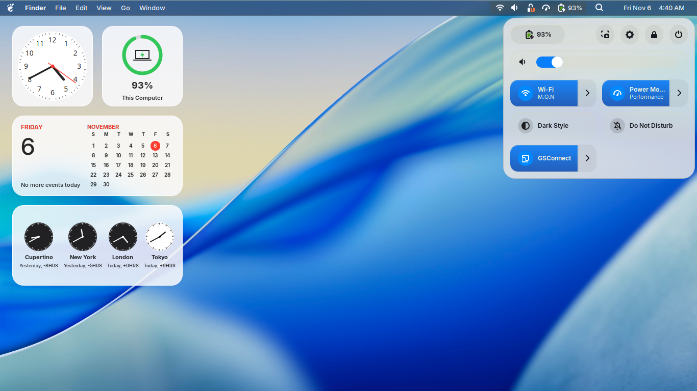
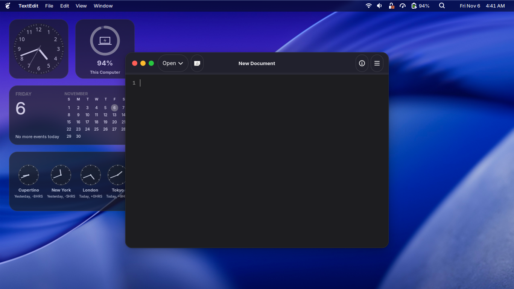
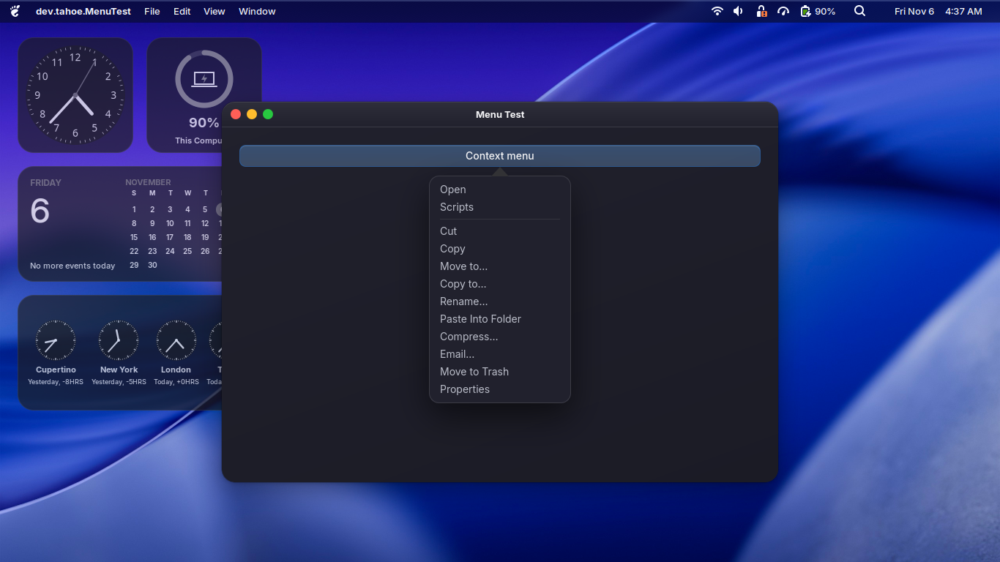
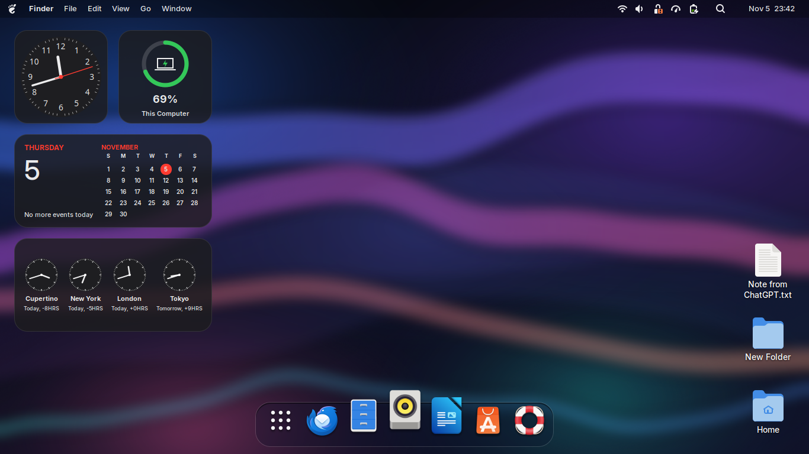

# macOS Tahoe Liquid Glass for Ubuntu GNOME

A reproducible, per-user recreation of **macOS Tahoe** on **Ubuntu 26.04 / GNOME Shell 50 / Wayland** — global menu bar, spring-magnifying floating dock, real backdrop blur, measured Liquid Glass materials, Spotlight search, Finder-style Files and coordinated Light/Dark modes — plus a complete automation framework that rebuilds everything on a fresh Ubuntu install with one command.

<p>
  
  
  
  
  
</p>

> **Status:** the desktop transformation is implemented and verified on the target machine. The automation project is self-contained and independent of any AI agent — install, verify, repair, restore and export all run from local scripts.

---

## Screenshots

Captured from an isolated nested GNOME Shell that mirrors the installed configuration, so the real session is never disturbed.

| Dark | Light |
|---|---|
|  |  |

| Dark Control Center | Light Control Center |
|---|---|
|  |  |

| GTK4 application / traffic lights | Context menu (single surface) |
|---|---|
|  |  |

| Dock glass with spring magnification |
|---|
|  |

---

## Highlights

### Liquid Glass materials
- **Real backdrop blur** via Blur my Shell (menu bar + Control Center/popovers, statically cached) and `Shell.BlurEffect` behind the dock — not a semi-transparent rectangle.
- **Different glass per surface**: translucent tinted panel, deeper dock glass, 50–56 % Control Center glass, lighter popovers/notifications, layered GTK window/toolbar/sidebar surfaces.
- **Light-catching edges, inner highlights, outer shadows, large radii** and measured tints.
- Palette derived from the actual Apple Tahoe wallpapers and UI references — dominant colours, luminance ranges and vivid accents are measured, not guessed.

### Physics and motion
- Floating **MacOSDock** replaces Ubuntu Dock, with a **damped-spring magnification integrator** (stiffness 320, damping 26, mass 1.0 by default). Neighbouring icons are displaced by the same spring field with elastic settle and subtle overshoot.
- Launch bounce, show/hide animation, hover transitions, GNOME popover/overview transitions. Motion is interaction-driven; nothing animates idly.
- Spring parameters are configurable in `config/motion.json` and through GSettings.

### Faithful Light and Dark modes
- One switch in Quick Settings changes GTK, icons, Shell theme, dock glass and blur together via the `tahoe-appearance-follow` daemon.
- Real Tahoe light/dark wallpapers (downscaled to 2560² for the Intel GPU); generated originals as offline fallback.

### The rest of the desktop
- Apple-style global menu bar, app menus, Finder menus, Apple system menu.
- Red/yellow/green traffic lights on the left for GTK3, GTK4 and libadwaita.
- Spotlight-style launcher on `Super+Space` (Rofi 2.0, palette-themed glass).
- Functional Control Center, Finder-style Nautilus, macOS display names, desktop widgets, WhiteSur icons/cursors, Inter typography.
- Preserved: GSConnect, AppIndicator support, Snap integration, Tiling Assistant, Desktop Icons NG, network/Bluetooth/sound/battery indicators.

---

## Supported systems

| | |
|---|---|
| Distribution | Ubuntu 26.04 LTS (validated 26.04.1, *resolute*) |
| Desktop | GNOME Shell 50.x |
| Session | Wayland (X11 accepted) |
| Reference hardware | Toshiba Satellite Pro C850-1ER, i5-3210M, Intel HD Graphics 4000, 16 GB RAM, 1366×768 |
| Minimum | 4 GB RAM, 2.5 GB free disk, GNOME 50 |

Other Ubuntu point releases with GNOME 50 are reported as *untested* and require `--allow-untested` after review. Other GNOME majors/distributions are refused unless the explicit, unsafe `--force-unsupported` flag is used. Extension metadata is never edited to force compatibility.

---

## Quick start

```bash
git clone https://github.com/michaelowusuntim6/macos-tahoe-ubuntu.git
cd macos-tahoe-ubuntu
./install.sh
# log out and back in once
```

Or use the all-in-one manager:

```bash
./tahoe.sh            # interactive menu
./tahoe.sh install    # install using the recommended profile
./tahoe.sh verify     # files, settings, dock, blur, daemon
./tahoe.sh restore    # return to the original desktop
```

Nothing is installed system-wide. Themes, icons, fonts, extensions and the Spotlight runtime stay in your home directory; the default install needs no `sudo` password.

### Installation profiles

| Profile | Description |
|---|---|
| `full` | Maximum glass/effects (dock blur σ22); automatic on capable GPUs |
| `lightweight` | Recommended for Intel HD 4000 (dock blur σ18, no Firefox chrome changes) |
| `visual-only` | Themes, icons, cursors, fonts, wallpapers and GTK styling only |
| `repair` | Diagnose and re-apply managed components |
| `restore` | Restore the pre-install configuration |

```bash
./install.sh --profile full
./install.sh --dry-run
./install.sh --offline
./install.sh --resume
./install.sh --restore
```

---

## All-in-one manager

`tahoe.sh` orchestrates every operation through safe menus and confirms destructive actions:

```
 1) Status & verification       6) Repair managed components
 2) Install                     7) Capture screenshots (headless)
 3) Dry run                     8) Export portable release
 4) Resume interrupted install  9) Restore original desktop
 5) Verify (with headless test) 10) Uninstall
                               11) Publish/update this repo on GitHub
                               12) Show logs & reports
```

It can also be used non-interactively:

```bash
./tahoe.sh status|install [profile]|dry-run|resume|repair|verify|headless|capture|export|restore|uninstall|publish|logs
```

The manager calls the same verified engine as the individual scripts; it does not replace or bypass them.

---

## How the glass is implemented (honest limits)

Apple's proprietary Liquid Glass renderer is **not** reproduced. GNOME/St has no `backdrop-filter`, refraction shader or CSS gradients in GNOME 50, and GTK cannot blur the desktop behind a window. The project uses the closest supportable stack:

| Layer | Technique |
|---|---|
| Menu bar | Translucent measured tint + static Blur my Shell blur + light-catching edge |
| Dock | `Shell.BlurEffect` on the dock rectangle + tint + specular rim + shadow |
| Control Center / popovers | Static popup blur + distinct tint/opacity/radius + inset highlight |
| Notifications | Softer larger-radius frosted material |
| GTK windows/toolbars | Layered tonal surfaces, gradients, edge highlights, shadows (no backdrop blur) |
| Motion | Damped spring for dock magnification; compositor transitions for popovers/overview; CSS transitions for hover states |

No continuous fake animation is used. Blur is static-cached wherever possible; popup blur exists only while a popup is open.

A note on GNOME CSS: St CSS supports `!important` but not gradient properties in GNOME 50; GTK's parser supports gradients but rejects `!important`. The generators emit each dialect correctly, and regression tests enforce it.

---

## Performance

Real `/proc` measurements from the target machine (details in [`docs/reports/PERFORMANCE_REPORT.md`](docs/reports/PERFORMANCE_REPORT.md)):

| Metric | Minimal shell | Full glass/motion stack |
|---|---|---|
| gnome-shell RSS (isolated, software) | 245.9 MB | 278.8 MB |
| gnome-shell CPU idle (isolated, software) | 6.5 % | 9.0 % |

Blur is statically cached for the panel/popovers; the dock effect is limited to the dock rectangle; previews are disabled; there is no duplicate dock or extra daemon loop. The lightweight profile is auto-selected on the HD 4000.

---

## Verification and testing

```bash
./verify.sh              # 93 live checks
./verify.sh --headless   # plus an isolated nested GNOME Shell test
./repair.sh              # diagnose then re-apply managed components
./uninstall.sh           # restore original dconf/files, remove owned assets
```

- 88 unit/integration tests (`python3 -m unittest discover -s tests -t tests`).
- Fresh-install simulation: exports the release, installs it **offline** into a temporary HOME/XDG tree with a private D-Bus session, runs the installer twice (idempotency), checks every artefact, dconf state, single-dock blacklist and machine isolation — without touching the live desktop.
- Live verification distinguishes *applied* from *loaded*: extensions that need a login are reported as warnings, never claimed active.

---

## Fresh Ubuntu re-installation

```bash
./export.sh
# releases/macos-tahoe-ubuntu-v1.1.1.tar.gz
# releases/macos-tahoe-ubuntu-v1.1.1.sha256
# releases/macos-tahoe-ubuntu-v1.1.1-manifest.json
```

Copy the archive and checksum **off the machine** before formatting. On the fresh install:

```bash
tar xzf macos-tahoe-ubuntu-v1.1.1.tar.gz
cd macos-tahoe-ubuntu-v1.1.1
sha256sum -c ../macos-tahoe-ubuntu-v1.1.1.sha256
./install.sh
```

The installer creates its own machine-specific backup and state; it never imports another machine's dconf. Apple-proprietary wallpapers are excluded from the release by default and re-downloaded/verified online; offline installs use the generated fallback wallpapers.

---

## Architecture

```text
macos-tahoe-ubuntu/
├── install.sh uninstall.sh verify.sh repair.sh export.sh tahoe.sh
├── README.md
├── docs/
│   ├── LICENSES.md CHANGELOG.md EXTENSIONS.md
│   ├── assets/                 # screenshots used by this README
│   └── reports/                # audit, compatibility, installation, performance, final
├── config/                     # desktop, appearance, palettes, motion, manifests
├── manifests/                  # lockfile, assets, repositories, support matrix
├── engine/                     # installer, verifier, dock/blur, daemon, exporter
├── assets/                     # themes, generated glass CSS, icons, fonts, wallpapers
├── extensions/                 # vendored TPCT shell + MacOSDock (patched)
├── tools/                      # reference analysis, glass generation, captures
├── tests/                      # 88 tests + fresh-install simulation
├── state/ backups/ logs/ reports/ releases/
```

Documentation index:

- [Detailed licences and attribution](docs/LICENSES.md)
- [Component selection and safety review](docs/EXTENSIONS.md)
- [Changelog](docs/CHANGELOG.md)
- [Initial audit](docs/reports/INITIAL_AUDIT.md)
- [Compatibility report](docs/reports/COMPATIBILITY_REPORT.md)
- [Installation report](docs/reports/INSTALLATION_REPORT.md)
- [Performance report](docs/reports/PERFORMANCE_REPORT.md)
- [Reference colour analysis](docs/reports/REFERENCE_ANALYSIS.md)
- [Final report](docs/reports/FINAL_REPORT.md)

---

## Troubleshooting

**The desktop has not changed yet** — log out and back in so GNOME Shell loads the Shell theme and extensions.

**Two docks / a static taskbar** — Ubuntu's session mode force-enables `ubuntu-dock`. The installer blacklists it in `disabled-extensions`; run `./repair.sh` and log out if an old session still has it loaded. `./verify.sh` checks the live state.

**A box around context menus** — GTK loads user CSS per application. Close and reopen the app (or log out) after updating. The GTK layer must not contain `!important`; `./verify.sh` and the test suite guard this.

**Spotlight does not open** — test `~/.local/bin/tahoe-spotlight`; Rofi uses XWayland because GNOME lacks wlr-layer-shell. Re-run `./repair.sh`.

**Blur too strong/weak** — tune `org.gnome.shell.extensions.blur-my-shell.panel` (sigma/brightness) or MacOSDock `dock-blur-sigma`; spring feel lives in `config/motion.json`.

**Diagnostics**

```bash
./tahoe.sh logs          # logs, reports, diagnostics
./scripts/diagnostics.sh # reports/diagnostics.json (never uploaded)
```

---

## Apple assets and licensing

- Apple wallpapers and reference screenshots are **not redistributed** by default; `export.sh` excludes them. Online installation downloads the two wallpapers from the user-provided URLs, verifies pinned SHA-256 hashes and uses them locally for personal use.
- Reference screenshots were used only to measure colours; they are not shipped in the portable release.
- Apple artwork remains Apple Inc. property. This is an independent project with no affiliation and no reproduction of Apple's proprietary rendering engine.
- Project code and generated glass assets are **GPL-3.0-or-later** (required by the vendored TPCT theme and WhiteSur assets). Full attribution: [docs/LICENSES.md](docs/LICENSES.md).

## Credits

TPCT Mac Theme · WhiteSur icons/cursors · Inter · GNOME User Themes · Blur my Shell · MacOSDock (MIT, vendored and patched) · Rofi · the GNOME and Ubuntu communities.
